# Running Crush on GMI Cloud models, tested on a real bug

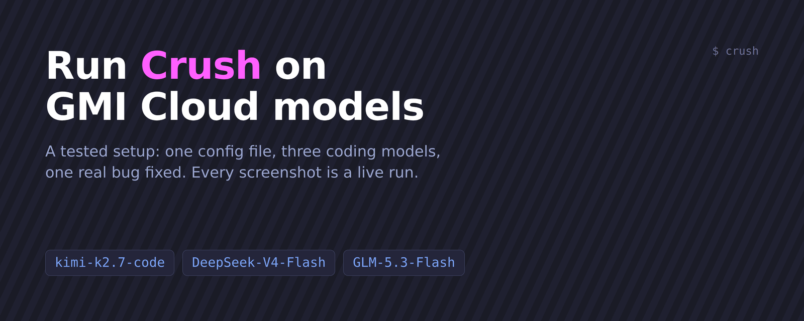

I am a GMI Cloud Clouder (a community ambassador, not an employee). I tested everything below on 9 November 2026 with Crush v0.100.0 and a real GMI API key. Every screenshot is a capture of a live run. I did not edit any of them. None shows the key.

[Crush](https://github.com/charmbracelet/crush) is a terminal coding agent from Charm. It reads your project, runs commands and edits files. It asks before it does. It can talk to any OpenAI-compatible endpoint. GMI Cloud is one. This guide connects the two, then has Crush fix a real bug with three different GMI models.

## What you get

One config file adds GMI to Crush. It gives you three coding models to switch between. I gave each model the same task: fix a failing test in a small Python project. All three made the same one-line fix.

| Model on GMI | Time | Prompt tokens | Output tokens | Cost at list price (upper bound) |
|---|---|---|---|---|
| `zai-org/GLM-5.3-Flash` | 11 s | 12,927 | 51 | $0.0020 |
| `deepseek-ai/DeepSeek-V4-Flash` | 25 s | 13,840 | 44 | $0.0019 |
| `moonshotai/kimi-k2.7-code` | 31 s | 12,078 | 83 | $0.0118 |

Each row is one run in `crush run` mode. Read the limits at the end before you treat this as a benchmark. It is one bug and one run per model.

## What you need

- Node.js with npm (this guide uses the npm package) or another install method from the [Crush README](https://github.com/charmbracelet/crush#installation).
- Python 3 for the demo project and `jq` for the key check.
- A GMI Cloud API key from the GMI console. Export it in your shell and keep it out of files:

```bash
export GMI_API_KEY="paste-your-key-here"
```

## Step 1: check that your key works

Ask GMI which models your key can see. This is the cheapest test and it fails fast if the key is wrong.

```bash
curl -s https://api.gmi-serving.com/v1/models \
  -H "Authorization: Bearer $GMI_API_KEY" \
  | jq -r '"models: \(.data | length)", (.data[].id | select(test("k2.7-code$|V4-Flash$|GLM-5.3-Flash$")))'
```

You should see the model count and the three ids this guide uses. I got 80 models.

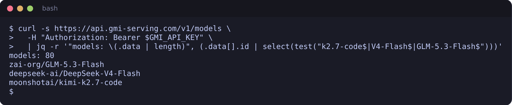

## Step 2: install Crush

```bash
npm install -g @charmland/crush && crush --version
```

I got `crush version v0.100.0`.

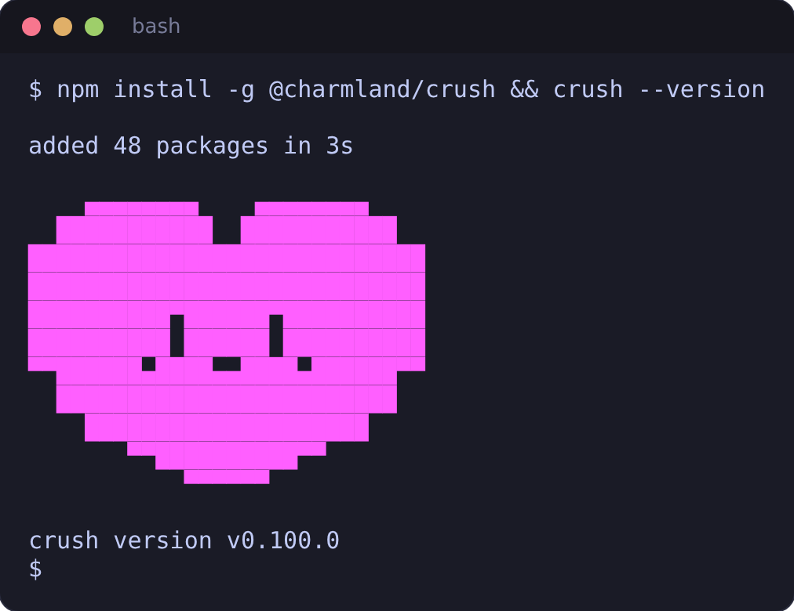

## Step 3: add GMI as a provider

Crush reads a file called `crushrc`. It is Bash with a few Crush commands, so there is no JSON to write. Save this as `~/.config/crush/crushrc`:

```bash
# GMI Cloud as a Crush provider. The key is read from your shell and never written to this file.
provider add gmi --type completions \
  --base-url "https://api.gmi-serving.com/v1" \
  --api-key "$GMI_API_KEY"

# Prices are dollars per 1M tokens, read from GMI's /v1/models.
model add gmi/moonshotai/kimi-k2.7-code \
  --name "Kimi K2.7 Code" \
  --context-window 262144 \
  --default-max-tokens 32768 \
  --price-input 0.95 \
  --price-output 4 \
  --price-cache-hit 0.19

model add gmi/deepseek-ai/DeepSeek-V4-Flash \
  --name "DeepSeek V4 Flash" \
  --context-window 1048575 \
  --default-max-tokens 32768 \
  --price-input 0.14 \
  --price-output 0.28 \
  --price-cache-hit 0.028

model add gmi/zai-org/GLM-5.3-Flash \
  --name "GLM 5.3 Flash" \
  --context-window 1048576 \
  --default-max-tokens 32768 \
  --price-input 0.15 \
  --price-output 0.5 \
  --price-cache-hit 0.03
```

Three details matter here:

- `--type completions` is the type Crush documents for non-OpenAI providers that speak the OpenAI chat API. GMI is one.
- The model id after `gmi/` is exactly the id from `/v1/models`, including the vendor prefix.
- `"$GMI_API_KEY"` is read from your shell when Crush starts, so the key never lands in the file. Crush treats `crushrc` as trusted code that runs in a shell. Only put lines in it that you wrote or read.

## Step 4: confirm Crush sees the models

```bash
crush models | grep '^gmi/'
```

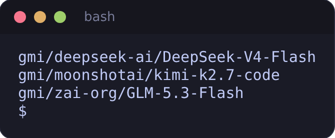

If nothing prints, check that `GMI_API_KEY` is exported in the same shell and that the file is at `~/.config/crush/crushrc`.

## Step 5: make a project with a real bug

The demo is two files. `invoice_total` is supposed to apply each line's discount but forgets to pass it on.

```python
# invoice.py
"""Small invoice helpers."""


def line_total(price, quantity, discount_percent=0):
    """Return the cost of one invoice line after a percentage discount."""
    discounted = price * (1 - discount_percent / 100)
    return round(discounted * quantity, 2)


def invoice_total(lines):
    """Sum the line totals. Each line is (price, quantity, discount_percent)."""
    total = 0
    for price, quantity, discount_percent in lines:
        total += line_total(price, quantity)
    return round(total, 2)
```

```python
# test_invoice.py
from invoice import invoice_total, line_total


def test_line_total_applies_discount():
    assert line_total(20.0, 3, 10) == 54.0


def test_invoice_total_applies_each_line_discount():
    lines = [(20.0, 3, 10), (5.0, 2, 0)]
    assert invoice_total(lines) == 64.0
```

Set it up with its own virtual environment. Do this before you start Crush. In my first attempt the project had no pytest. Crush spent several steps finding that out and building a `.venv` itself. It worked, but it is not the clean path.

```bash
mkdir ~/invoice-demo && cd ~/invoice-demo && git init
python3 -m venv .venv && source .venv/bin/activate && pip install pytest
printf '.venv/\n__pycache__/\n.pytest_cache/\n.crush/\n' > .gitignore
git add -A && git commit -m "Add invoice helpers"
python -m pytest -q
```

One test fails. The total is 70.0 and should be 64.0.

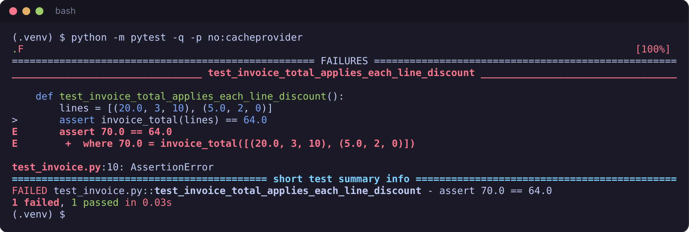

## Step 6: start Crush

From the project folder:

```bash
crush
```

Crush asks whether to initialize the project. I pressed `n` for this test. It then shows the main screen. The line under the folder name shows the active model.

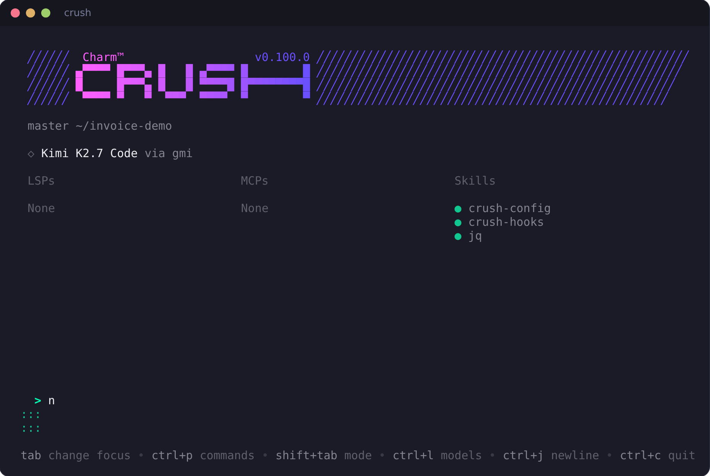

Crush chose `Kimi K2.7 Code via gmi` on its own because GMI was the only provider it could use. If other provider keys are set in your shell, Crush may pick one of those instead. When I first launched it with my full environment loaded, it picked an OpenAI model. Press `Ctrl+L` to check and switch.

## Step 7: pick a model

Press `Ctrl+L`. The three GMI models are listed at the top.

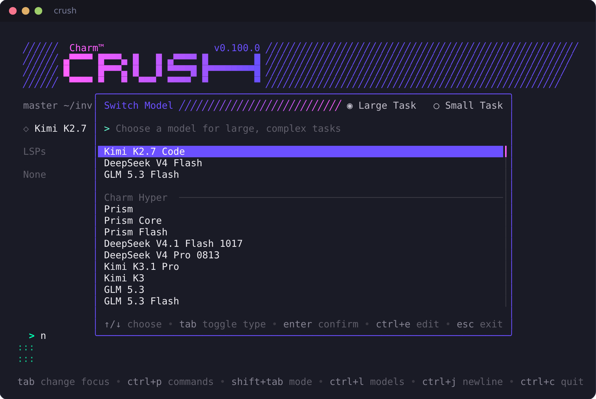

Press `Esc` to keep Kimi K2.7 Code.

## Step 8: give Crush the task

Type this and press Enter:

```text
Run the tests, find why test_invoice_total_applies_each_line_discount fails, fix the bug in invoice.py, and run the tests again.
```

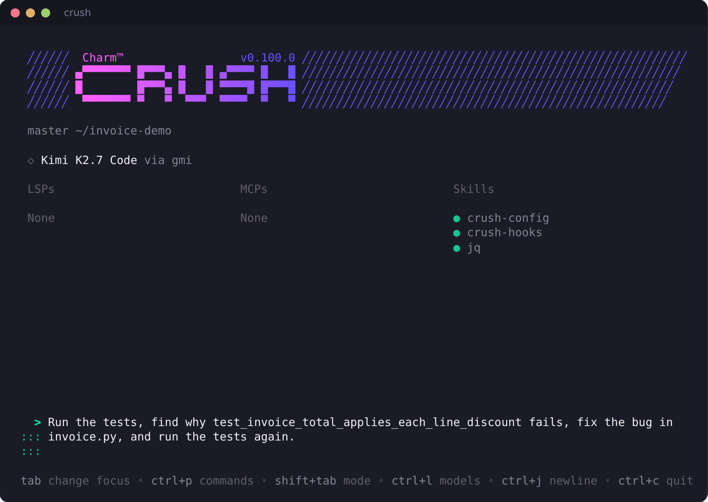

Crush asks permission before each tool. The first request is to run the tests.

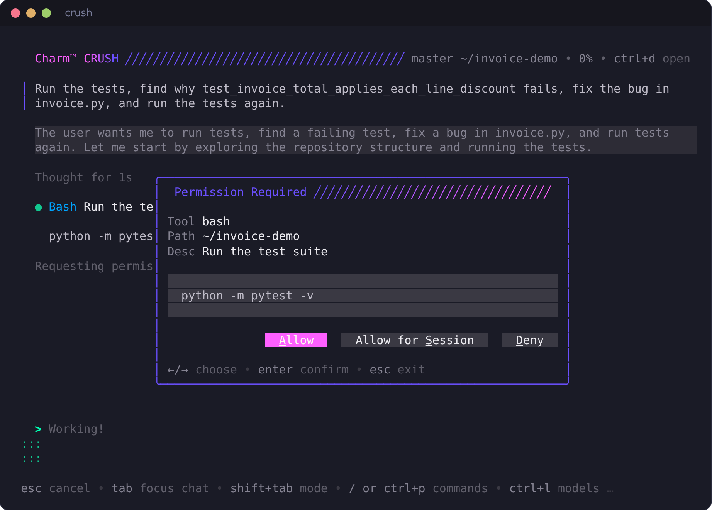

Press Enter on **Allow**. The second request is the edit. It shows the exact change before anything is written. This is the screen to read carefully.

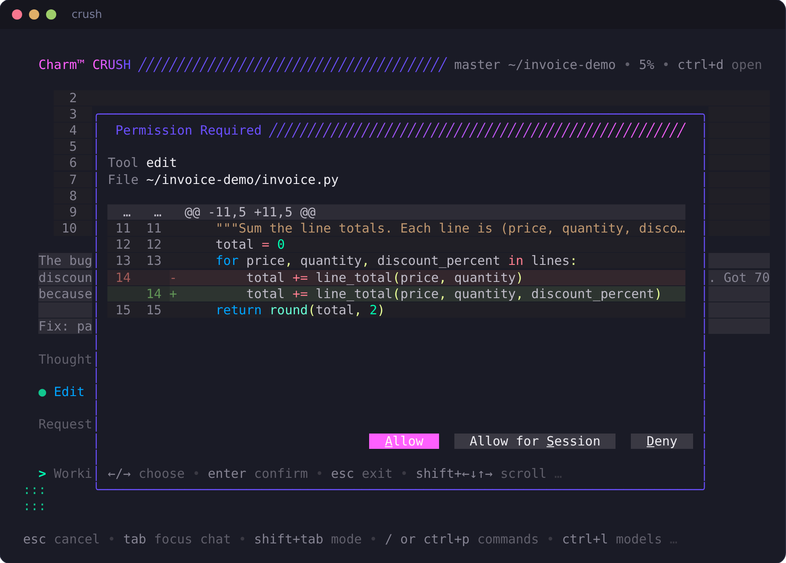

Allow it, then allow the final test run. This took 44 seconds in the interactive session I screenshotted, including the time I spent pressing Enter. Crush finishes with a summary and the passing test output.

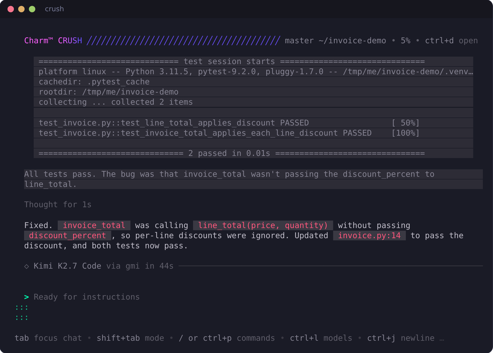

Check the result yourself. Crush's summary is not proof.

```bash
git diff --stat && python -m pytest -q
```

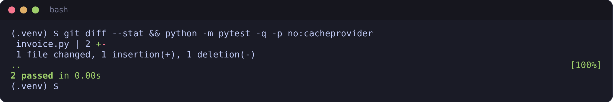

## Step 9: run it without the screen

Crush can also run one prompt and exit. This is how I timed the three models. The `-m` flag takes `gmi/` plus the model id.

```bash
crush run -y -q -m gmi/zai-org/GLM-5.3-Flash \
  "Run the tests, find why test_invoice_total_applies_each_line_discount fails, fix the bug in invoice.py, and run the tests again."
```

`-y` skips every permission prompt. Use it only in a throwaway folder like this one, because Crush will then run commands and edit files without asking.

## What went wrong and what I did not check

- **A model GMI lists did not work.** I first put `Qwen/Qwen3-Coder-480B-A35B-Instruct-FP8` in this guide. Every request to it returns `400` with `UnavailableModel: The requested model has been deprecated and is no longer available`, even a plain curl with no Crush involved. I replaced it with GLM 5.3 Flash. That is not an isolated case. I sent one 16-token request to each of the 80 listed models. Sixty-one answered. Nineteen did not: thirteen returned `503` (`Max retries (2) exhausted`), four returned the same `UnavailableModel` error, one returned `400 Invalid model name` and one returned `404`. This was one pass on one day, so some 503s may be temporary. Run `scripts/probe-models.sh` to see today's count.
- **Python scripts can get a `403`.** My first probe used Python's default `urllib` and got `403 error code: 1010` on models that worked fine in Crush. The same request with a curl User-Agent returned `200`. If you script against the API from Python, set a User-Agent.
- **Crush's cost figure did not match list price.** For the Kimi run, Crush recorded 14,179 prompt tokens and 68 output tokens and showed a cost of about $0.067. At the prices in my config that is at most about $0.014. I did not find out why. I also did not compare either number with my GMI billing page. The cost column in the table above is my own calculation from the token counts and the list prices. It ignores cache discounts, which is why I call it an upper bound. `/v1/models` also returns a `discount_to_user` field (0.35 for DeepSeek V4 Flash and 0.5 for GLM 5.3 Flash). I did not confirm how it applies to a bill.
- **The task is tiny.** One bug, three runs, one per model. All three fixed it the same way, so this shows the setup works. It does not rank the models. A bigger repo or a harder bug could change the order.
- **Most of the tokens are overhead.** The repo is about 20 lines but each run sent 12,000 to 14,000 prompt tokens. That is Crush's own instructions and tool descriptions plus the conversation. Expect the same fixed cost on any project.
- **The agent is not deterministic.** My first interactive run took a longer route (it created a virtual environment on its own). The second run of the same prompt took a direct route. Timings will vary.

## Files

- [`crushrc`](crushrc): the exact config I tested.
- [`demo/invoice-demo`](demo/invoice-demo): the buggy project.
- [`scripts/probe-models.sh`](scripts/probe-models.sh): sends one small request to every listed model and prints how many answer.

## Links

- Crush: https://github.com/charmbracelet/crush
- GMI Cloud docs: https://docs.gmicloud.ai
